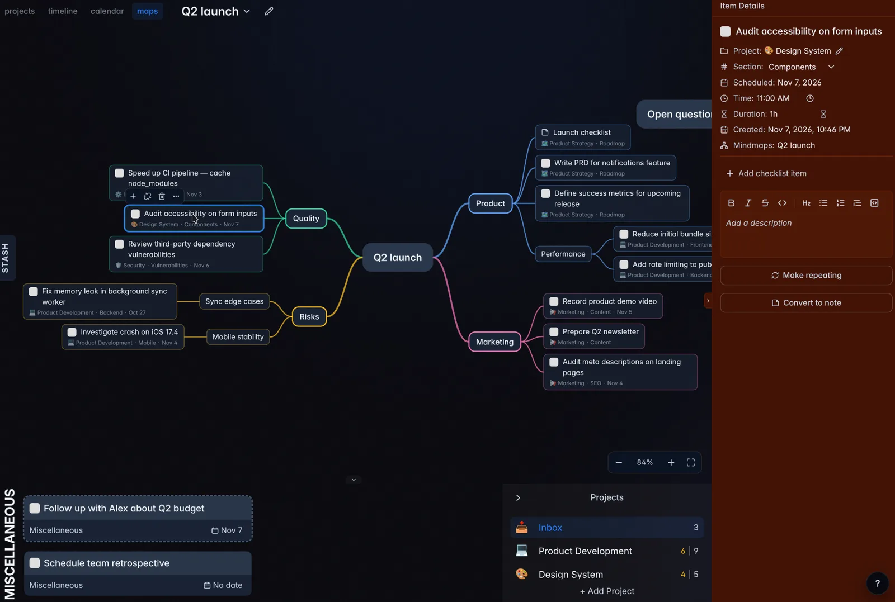

Plan visually with mindmaps that hold your real tasks, keep notes next to tasks, select many items at once, and undo any change.

## What's new

### Mindmaps

<figure style="max-width: 2000px">

</figure>

Open **maps** in the view switcher to lay out ideas around a central topic. Branches can hold plain topics, tasks, and notes from any project.

- Press `Tab` to add a subtopic and `Enter` to add a topic below. Turn a topic into a task or a note with the buttons above it.
- Drag tasks and notes from the project panel below the map onto a topic, or onto empty space to start a new branch. The same task can sit on several topics and several maps.
- Task and note topics stay linked to their item. Completing or renaming one on the map changes it everywhere, and the details panel lists every mindmap it appears on.
- Double-click empty space to start a floating topic with its own branches.
- Select several topics by dragging across empty space, `Shift`-click, or `Ctrl`/`Cmd`-click, then move, copy, cut, or remove them together. Task actions such as scheduling, moving, and stashing apply to every selected task.
- Paste an outline from MindNode or another outliner, a Markdown list, bulleted lists from Google Docs or Notion, or OPML, and each line becomes a topic with its nesting kept.
- Navigate with `h`/`j`/`k`/`l`, reorder with `Ctrl` and those keys, and collapse a branch with `.`. On touch screens, pan with one finger, pinch to zoom, and use the bottom bar for topic actions.

Removing a topic or deleting a whole mindmap keeps its tasks and notes in their projects.

### Notes

A note is a project section item with a title and a description but no done state. Use it for meeting notes, a project brief, or any reference text that belongs between tasks.

Select **Convert to note** in a task's menu or details to turn it into a note in the same place, and **Convert to task** to turn it back. With a note focused, press `o` or `Shift+O` to add another note below or above it. Deleted notes go to Trash like tasks.

### Undo and redo

Press `u`, `Cmd+Z`, or `Ctrl+Z` outside a text field to undo your last change, and `Cmd+Shift+Z`, `Ctrl+Shift+Z`, or `Ctrl+R` to redo it. Undo covers tasks, notes, templates, projects, sections, schedules, Stash, checklists, mindmaps, and Trash.

Deleting an item or converting between a task and a note also shows a popup with an **Undo** button for a few seconds.

Each tab keeps its own history until you reload it. Changes synced from other devices are never undone, and a step that was edited elsewhere in the meantime is skipped with a message.

### Select several items

- `Shift`-click to select a range, `Ctrl`/`Cmd`-click to add or remove one item, or extend the selection with `Shift+J`/`Shift+K` or `Shift` and the arrow keys.
- Drag any selected item to move them all in order. Complete, schedule, stash, move, and delete shortcuts, and the action menu, apply to the whole selection.
- Copy, cut, and paste tasks and notes with `Cmd`/`Ctrl` + `C`, `X`, and `V`, including between projects, days, and Stash. Copies keep their description and checklist.

### Calendar keyboard shortcuts

The calendar now works from the keyboard too:

- Move between tasks with `h`/`j`/`k`/`l` or the arrow keys.
- Move a task to another day with `Ctrl+h`/`Ctrl+l`, or 15 minutes earlier or later with `Ctrl+k`/`Ctrl+j`.
- Press `o` to add a task that starts when the focused one ends, or `Shift+O` for the half hour before it.
- `Space`, `1`–`3`, `t`, `Shift+S`, `Enter`, and the delete keys work as they do in lists.

## Fixes

- Changes are written to local storage before other tabs see them and before downloaded sync data is acknowledged, so closing a tab mid-sync no longer risks losing changes.
- A new space whose first sync fails retries as soon as your account syncs.
- Mobile timeline controls no longer cover board content and are easier to tap, and project panels start folded on small screens.

## API changes

- New mindmap endpoints list, create, read, rename, and delete mindmaps, and add, update, move, and remove their nodes.
- New note endpoints read, update, move, and delete notes, and convert tasks to notes and back.

## Upgrade notes

- Self-hosted installations: pull `ghcr.io/will-be-done/will-be-done:0.14.0` (or `latest`) and recreate the container. The sync protocol is unchanged, and existing data needs no manual migration.
- Update the desktop app so `Cmd+Z` and `Ctrl+Z` from its Edit menu undo app changes. Older desktop builds still undo only text edits with those keys; `u` works in any build.
