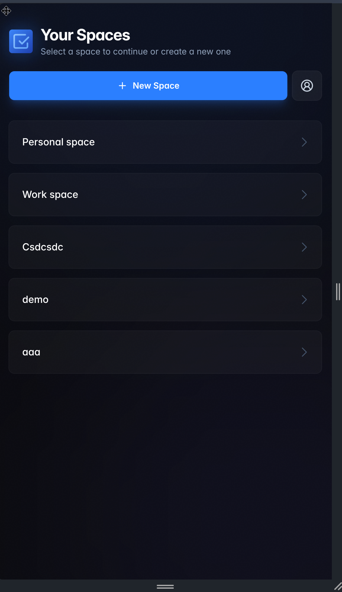
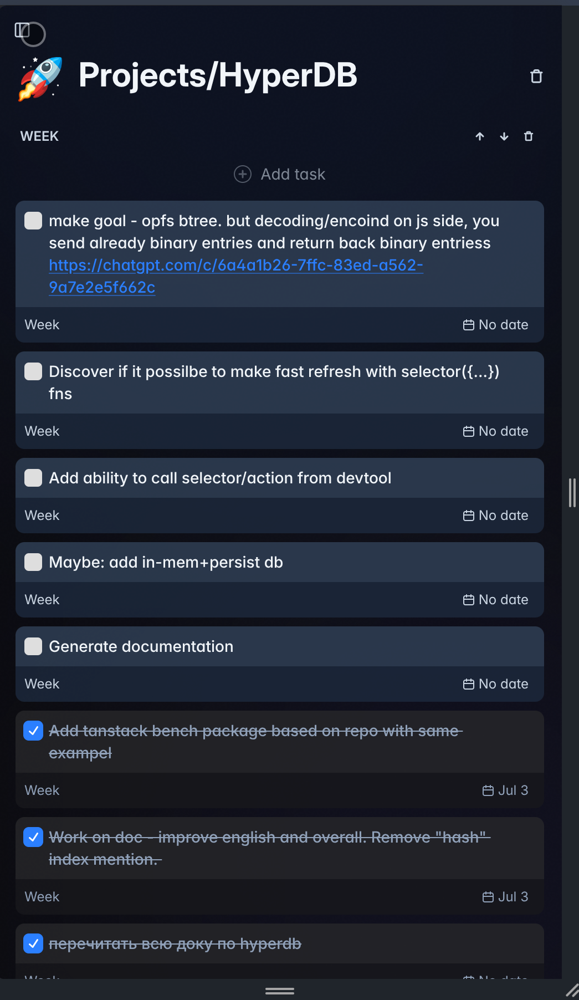

# Mobile App (Expo)

`apps/mobile` is a local-first React Native app built with Expo. The first milestone covers
**login**, **space selection**, and the **inbox**. It looks the same as the web app's small-screen
layout and runs the same data layer: HyperDB, `@will-be-done/slices`, and the sync protocol from
`docs/sync.md`.

## Decisions

- **Local-first.** HyperDB on SQLite (`expo-sqlite`) plus the existing sync protocol, not an
  online-only client over the v1 HTTP API. Selectors and actions from `@will-be-done/slices` are
  reused as-is.
- **One shared client package**, `@will-be-done/client` in `packages/client`. It holds the sync
  engine and the other non-DOM client pieces that web and mobile both need. Platform differences
  are injected through one `ClientPlatform` adapter.
- **No Google sign-in** in this milestone. Email and password only.
- **Styling: Uniwind** (Tailwind v4 for React Native). Theme tokens live in one shared CSS file
  imported by both web and mobile. Uniwind compiles the oklch tokens unchanged.

## Reference design

These screenshots show the web app at a phone-sized width. The mobile app matches them.

| Space selection                       | Project / inbox view                       |
| ------------------------------------- | ------------------------------------------ |
|  |  |

Source components on web:

- Login: `apps/web/src/routes/login.tsx`
- Spaces: `apps/web/src/routes/spaces.index.tsx`, `components/Layout/StandalonePage.tsx`,
  `components/Layout/AppLogo.tsx`, `components/Layout/BackgroundOrbs.tsx`
- Inbox: `components/ProjectView/ProjectDetailView.tsx` (small-screen branch),
  `components/ProjectView/ProjectTaskPanel.tsx` (`embedded`), `components/Task/Task.tsx`
- Tokens: `packages/client/src/theme/tokens.css`

## Shared package: `@will-be-done/client`

`apps/slices` stays the pure domain layer shared with the server. `packages/client` is the
client-only runtime shared by web, desktop (through web), and mobile.

```
packages/client/src/
  sync/        initDbStore, Syncer, sync actions, clock, change hooks, persist queue,
               cross-instance changes, space/user DB configs, sync status, and their tests
  sync/platform.ts   ClientPlatform interface + singleInstanceCoordination
  auth/        createAuthStore: token, userId, last space, space names over injected storage
  utils/       State, linkifyText, formatScheduleDate ("No date" / "MMM d" / "MMM d, yyyy")
  theme/tokens.css   design tokens (@theme) used by web and mobile
```

Subpath exports: `./sync`, `./auth`, `./utils`, `./theme/tokens.css`.

These stay in `apps/web`: DOM and React-DOM components, the focus store, DnD, the popup and
sidebar stores, the demo space config, the tRPC client, and the web platform adapter
(`apps/web/src/store/platform.ts`). Each app keeps its own tRPC client because the server URL and
reconnect triggers differ by platform.

### Platform adapter

`ClientPlatform` (`packages/client/src/sync/platform.ts`) covers only what differs between web and
mobile:

| Concern                     | Web (`apps/web/src/store/platform.ts`)            | Mobile (`apps/mobile/src/db/platform.ts`)         |
| --------------------------- | ------------------------------------------------- | ------------------------------------------------- |
| `apiUrl`                    | `""` (same origin)                                | `EXPO_PUBLIC_API_URL`                             |
| `storage` (client id, etc.) | `localStorage`                                    | `expo-sqlite/kv-store`                            |
| `persistentStorage`         | existing wa-sqlite / IndexedDB selection          | `expo-sqlite` → HyperDB `AsyncSqlDriver`          |
| `subscribeChangesAvailable` | tRPC `onChangesAvailable` over WebSocket          | same                                              |
| `coordination`              | `broadcast-channel` leader election + fan-out     | `singleInstanceCoordination` (always leader)      |
| `lifecycle`                 | `visibilitychange`, `online`, `focus`, `pagehide` | `AppState` (`active` / `background` / `inactive`) |
| `startAutoBackup`           | IndexedDB `AutoBackuper`                          | none                                              |
| auth token                  | `localStorage`                                    | `expo-secure-store`                               |

The startup lock uses `navigator.locks` when present and an in-process queue otherwise, so it needs
no adapter.

## Mobile app: `apps/mobile`

```
apps/mobile/
  src/app/_layout.tsx                  polyfills, Uniwind CSS, Inter fonts, QueryClient, overlay host
  src/app/index.tsx                    redirect: login / last-used space / spaces
  src/app/login.tsx
  src/app/spaces/index.tsx             user DB + space list
  src/app/spaces/[spaceId]/_layout.tsx space DB (initDbStore) → DBProvider, loading state
  src/app/spaces/[spaceId]/index.tsx   inbox
  src/db/                              ClientPlatform, expo-sqlite driver, useDbStore hook
  src/lib/                             config (API URL), storage, auth, tRPC, query client
  src/components/                      Text, AppLogo, BackgroundOrbs, Screen, overlays (prompt +
                                       action sheet), TaskCard, SectionBlock, SyncIndicator, …
  global.css                           Tailwind + Uniwind + shared tokens + Inter font families
```

Stack and workspace notes:

- **Expo SDK 58 / React Native 0.88 / React 19.3.0.** React Native needs the exact React version
  its renderer was built with. `pnpm-workspace.yaml` keeps the global `react: 19.2.7` pin for web
  and desktop and overrides it for mobile only (`"@will-be-done/mobile>react": "19.3.0"`).
- **One HyperDB instance per bundle.** Workspace packages (`slices`, `client`) resolve their own
  install of HyperDB, built against React 19.2.7. `metro.config.js` resolves `react` and
  `@will-be-done/hyperdb` from the app, and `tsconfig.json` maps the same modules with `paths` so
  types agree with the bundle.
- **Polyfills** (`src/polyfills.ts`): `crypto.getRandomValues`, `crypto.randomUUID` and
  `crypto.subtle.digest` from `expo-crypto`. Hermes has none of these. HyperDB and `uuidv7` need
  the first two; the sync engine hashes payloads with SHA-256.
- **Fonts.** Inter is loaded as one family per weight (`@expo-google-fonts/inter`), because React
  Native picks a weight by family. Use `font-inter-medium` / `-semibold` / `-bold` instead of
  `font-medium` etc. The `Text` / `TextInput` wrappers default to `font-inter`.
- **Visual effects.** The web blur orbs and logo glow become `react-native-svg` radial gradients.
  Button glows use the `boxShadow` style, and `ring-*` becomes `border-*`.
- **Keyboard.** `KeyboardAvoidingView` uses `behavior="padding"` on both platforms; Android
  edge-to-edge does not resize the window.

### Screens

**Login** follows `login.tsx`:

- Logo, "Welcome back", and a form card with an error box and a "Sign in →" button.
- "Forgot password?" is shown when `getAuthConfig.emailEnabled`. It and "Sign up" open the web
  pages in the browser.

**Spaces** matches `spaces.png`:

- Header, "New Space" button, and an account button whose action sheet has "Log out".
- Space cards; long press opens Rename/Delete (web shows these on hover).
- Empty state.

**Inbox** matches `project-view.png`:

- Top bar with "‹ Spaces" and the sync indicator.
- Emoji and title header.
- Each section has its controls (move up/down, delete, tap the title to rename), "Add task", the
  todo cards, the first three done cards and "Show more (n)". "Add section" closes the list.
- Task cards:
  - Tap the checkbox to toggle done.
  - Tap the card to edit the title inline; it saves on blur or Enter.
  - Tap a link to open it.
  - Long press opens Delete.

Out of scope for now: drag to reorder, item details, date picker, repeat modal, checklist, stash,
emoji picker, renaming the project, other projects, and Today.

## Running it

```sh
pnpm dev:server                                   # API on :3000
cd apps/mobile
EXPO_PUBLIC_API_URL=http://10.0.2.2:3000 pnpm start   # Android emulator → host machine
```

Open the app in Expo Go (SDK 58) or press `a` / `i` in the Expo CLI. Without `EXPO_PUBLIC_API_URL`
the app talks to `https://app.will-be-done.app`. Note: with `CI=1` set, Metro disables file
watching and reloads.

`pnpm ts` at the repo root also type-checks the mobile app.

## Status

Verified on the Android emulator (Pixel 9, API 36, Expo Go) against a local API:

- log in;
- create a space, which syncs the user DB;
- open the inbox, add tasks, edit titles, linkify URLs, complete and delete tasks, which syncs
  the space DB;
- wipe the app's data, log in again, and see the space and tasks restored from the server.

Not done yet:

- iOS has not been run.
- No network-state wake-up (NetInfo): sync wakes on foreground, WebSocket notifications, and the
  60 s poll.
- A 401 shows the sync error ("Sign in again…") but does not sign out automatically.
- No mobile lint config or automated UI tests.
- No app icon or splash screen.
